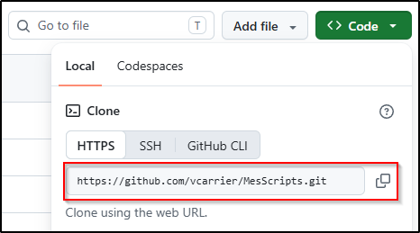
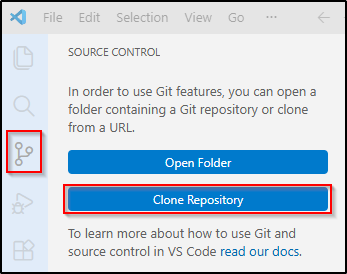
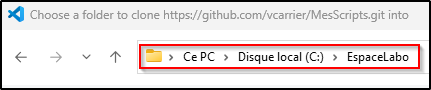
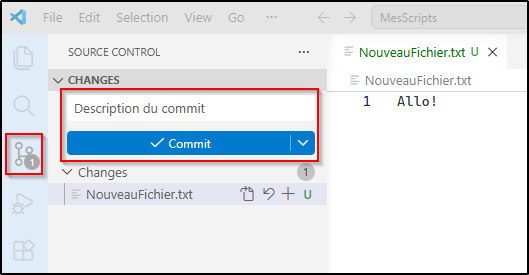
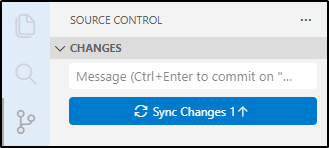
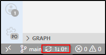

Visual Studio Code possède un client Git intégré à même l'interface de développement. Voici comment l'utiliser.

## Installation du client git

D'abord, il faut s'assurer que le logiciel de gestion de code source [git](https://git-scm.com/) est installé sur votre ordinateur (c'est déjà fait sur le poste du laboratoire).

Vous pouvez le faire soit avec [le paquet d'installation](https://git-scm.com/install/windows) ou avec `winget`.

<ConsoleWindow title="Adminstrateur: cmd.exe">
```text
C:\> winget install --id Git.Git -e --source winget
```
</ConsoleWindow>

## Configuration initiale

Il faut également configurer Git avec votre adresse courriel et nom d'utilisateur. Vous n'avez qu'à le faire une fois sur votre ordinateur personnel ou vos VM, mais vous devrez le faire à chaque fois sur votre ordinateur du laboratoire. Je vous encourage à faire un script.

```cmd title="monscript.cmd"
@echo off
git config --global user.name "nomdutilisateur"
git config --global user.email "adresse@courriel.com"
```

:::tip
Pour connaître la configuration de votre client git, lancez la commande `git config --list`. Par exemple:

<ConsoleWindow backgroundColor="#012456">
```text
PS C:\> git config --list | ? { $_ -match "^user\." }
user.name=pmeilleur
user.email=paul.meilleur@cegepmontgrand.ca
```
</ConsoleWindow>
:::

## Clonage local du dépôt

Authentifiez-vous sur GitHub et accédez à votre dépôt. À la racine du dépôt, cliquez sur le bouton **Code** et copiez l'URL HTTPS.



Démarrez une **nouvelle fenêtre** de Visual Studio Code. Dans le panneau **Gestion de code source**, cliquez sur **Clone repository** et **collez l'URL** de votre dépôt. Vous pourriez devoir **vous authentifier à GitHub** pendant le processus.



Sélectionnez un répertoire cible où le dépôt sera créé. Le répertoire racine de votre dépôt sera créé dans ce répertoire. Par exemple, si vous choisissez `C:\EspaceLabo` comme répertoire et que votre dépôt s'appelle `MonDepot`, votre dépôt local sera dans `C:\EspaceLabo\MonDepot\`.



> ***Note:** Il n'est pas recommandé d'utiliser un répertoire synchronisé ailleurs (OneDrive, Google Drive, etc.). Utilisez plutôt un répertoire purement local, comme `C:\EspaceLabo` dans nos laboratoires ou `%USERPROFILE%\repos` sur votre ordinateur personnel. `%USERPROFILE%` est la variable d'environnement qui pointe vers votre profil utilisateur.*

## Commit / push

Pour travailler dans votre dépôt, vous devez ouvrir le répertoire de votre dépôt dans l'espace de travail de VS Code (Fichier / Ouvrir le dossier). Au fur et à mesure que vous modifiez votre code, vous pourrez voir dans la barre d'icône à gauche une pastille indiquant le nombre de fichiers qui ont changé depuis le dernier commit.

Pour effectuer un commit, cliquez sur cette pastille. Vous verrez la liste des fichiers qui ont changé. Pour inclure tous les changements dans le commit, incrivez simplement une description du commit et cliquez sur le bouton **Commit**.



Puis l'oubliez pas de pousser le changement sur GitHub en cliquant sur le bouton **Sync Changes**.



:::warning
Avant de commencer à travailler sur votre projet, assurez-vous toujours que votre clone local possède la plus récente version de votre code. Dans la barre du bas, vous pouvez voir combien de commits sont en attente de tirage. S'il y en a, cliquez sur la flèche circulaire pour synchroniser le dépôt.


:::
