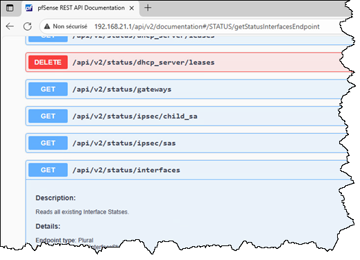
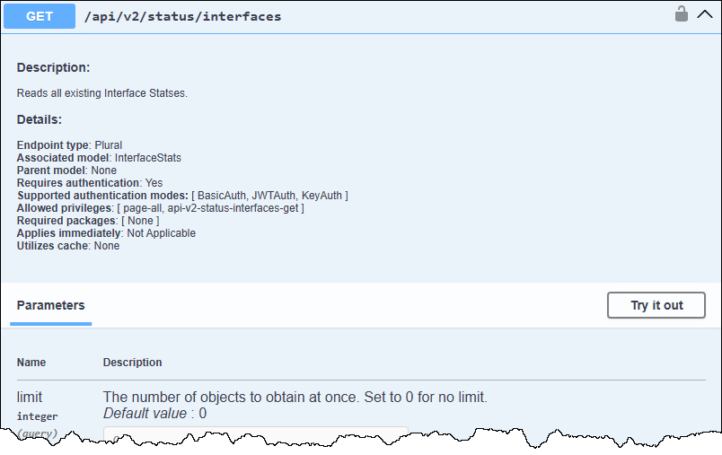

## Protocole HTTP (et HTTPS)

HTTP est un protocole de couche 7 (application) opérant sur TCP. Les ports standards utilisés sont 80 (http) et 443 (https). HTTP et HTTPS fonctionnent de manière similaire, mais HTTPS comprend du chiffrement ainsi qu'une authentification SSL/TLS. Pour ce qui concerne ce cours, les différences de fonctionnement sont prises en charge par le système d'exploitation.

Ce protocole fonctionne en mode requête-réponse: Le client émet une requête et formule sa demande ainsi que les informations nécessaires dans son en-tête, puis le serveur interprête la requête et renvoie la réponse au client.

```
 https://www.serveur.com/dossier/page.html?var1=foo&var2=bar
└─┬───┘ └─┬────────────┘ └──┬────────────┘ └────────┬───────┘
  │       │                 │    ┌──────────────────┴──────────────────────┐
  │       │                 │    │ Variables                               │
  │       │                 │    │   (variable=valeur, séparées par des &) │
  │       │                 │    └─────────────────────────────────────────┘
  │       │      ┌──────────┴───────────────┐
  │       │      │ Chemin vers la ressource │
  │       │      └──────────────────────────┘
  │    ┌──┴─────────────────────────────────┐
  │    │ Adresse DNS (ou IP) du serveur Web │
  │    └────────────────────────────────────┘
┌─┴─────────────────────────┐
│ Protocole (HTTP ou HTTPS) │
└───────────────────────────┘
```

### Méthodes HTTP

Le protocole HTTP permet différentes méthodes. La plus connue est **GET**, qui permet d'obtenir le contenu d'une ressource. On connait aussi **POST**, qui est utilisé lorsque le client doit soumettre une information au serveur (par exemple, le contenu d'un formulaire). Mais il existe plusieurs autres méthodes moins connues.

| Méthode | Description                                                               |
| :------ | :------------------------------------------------------------------------ |
| GET     | Demande une ressource (un fichier, un objet, etc.)                        |
| POST    | Envoie des données à une ressource (la requête a un payload)              |
| PUT     | Crée ou remplace une ressource sur le serveur                             |
| HEAD    | Ne demande que les informations sur la ressource, pas son payload         |
| DELETE  | Supprime une ressource du serveur                                         |
| OPTIONS | Obtient les options d’une ressource ou du serveur                         |
| TRACE   | Demande au serveur de retourner ce qu’il a reçu, à des fins de diagnostic |
| CONNECT | Permet d’ouvrir un tunnel de communication (par exemple, SSL)             |
| PATCH   | Modifie une ressource, comme PUT, mais partiellement                      |

### Codes de retour

Le protocole HTTP prévoit une série de codes numériques à renvoyer au client afin de lui signaler le succès ou l'échec de la requête.

- 200: Succès (par exemple, `200 OK`)
- 300: Redirection
- 400: Erreur du client (par exemple, `404 NOT FOUND` ou `403 FORBIDDEN`)
- 500: Erreur du serveur

## Requêtes Web avec PowerShell

La commande `Invoke-WebRequest` permet d'envoyer une requête HTTP ou HTTPS à un serveur Web.

Pour télécharger un fichier par le Web, il y a deux manières:

On peut spécifier le paramètre `-OutFile` à `Invoke-WebRequest`.

```powershell showLineNumbers
$uri = "https://download.sysinternals.com/files/SysinternalsSuite.zip"
$dossierOutils = "C:\Outils"
$zipPath = Join-Path -Path $dossierOutils -ChildPath "SysinternalsSuite.zip"
$dossierSysinternals = Join-Path -Path $dossierOutils -ChildPath "SysinternalsSuite"

New-Item -Path $dossierOutils -ItemType Directory | Out-Null
#highlight-next-line
Invoke-WebRequest -Uri $Uri -OutFile $zipPath
Expand-Archive -Path $zipPath -DestinationPath $dossierSysinternals
Remove-Item $zipPath
```

Ou on peut également utiliser BITS (Background Intelligent Transfert Protocol), un service inclus dans Windows qui offre une gestion plus intelligente des flux de téléchargement et permet d'effectuer du téléchargement en arrière-plan ou avec une meilleure utilisation de la bande passante.

```powershell showLineNumbers
# Téléchargement
$uri = "https://code.visualstudio.com/sha/download?build=stable&os=win32-x64"
$dest = "$env:TEMP\vscodesetup.exe"
#highlight-next-line
Start-BitsTransfer -Source $uri -Destination $dest

# Installation
$arg = "/VERYSILENT /MERGETASKS=!runcode,addcontextmenufiles,addcontextmenufolders"
Start-Process -FilePath $dest -ArgumentList $arg -Wait

# Nettoyage
Remove-Item $dest
```

:::tip Performance de Invoke-WebRequest
La commande `Invoke-WebRequest` utilisée pour le téléchargement de fichiers est incroyablement lente, surtout sous Windows PowerShell. La console montre une barre de progression, mais la gestion de cet affichage ralentit l'exécution de la commande. Il y a deux manières d'améliorer grandement les performances:

- Avant l'appel de `Invoke-WebRequest`, affectez à `$ProgressPreference` la valeur `SilentlyContinue` afin de masquer la barre de progression
- Utilisez BITS
:::

## API REST

Un API REST (*REpresentational State Transfer*) est une interface qui permet à un **programme** de communiquer avec un service au moyen de requêtes HTTP. Plutôt que d'utiliser HTTP pour demander des pages Web ou des fichiers destinés à un humain, un programme va envoyer des commandes et obtenir des données brutes en utilisant le protocole web, déjà très robuste et universellement accepté. De nombreux systèmes offrent un API WEB afin de permettre leur contrôle de manière programmatique, intégrée dans des scripts et sans besoin d'intéraction humaine.

### Format JSON

La vaste majorité des API REST utilisent le langage d'échange JSON afin de communiquer dans un langage commun. Il existe d'autres langages d'échange tels que XML et YAML, mais pour cet usage, JSON demeure de loin le standard le plus solidement établi.

À titre de rappel, le format JSON permet de représenter sous forme de texte un ensemble de listes et de dictionnaires. En PowerShell, cela revient à une structure composée de tableaux (array) et de PSCustomObjects.

```json
[
  {
    "Marque": "Ford",
    "Modele": "Mustang",
    "Annee": 1964,
    "Accessoires": []
  },
  {
    "Marque": "Reliant",
    "Modele": "Robin",
    "Annee": 1988,
    "Accessoires": [
      "Moteur V8",
      "Dés en minou"
    ]
  },
  {
    "Marque": "Toyota",
    "Modele": "Tercel",
    "Annee": 1991,
    "Accessoires": []
  }
]
```

Pour convertir du contenu JSON en objet PowerShell, utilisez la commande `ConvertFrom-Json`. On lui passe **du texte** formaté en JSON, et elle produit un assemblage de tableaux `[Object[]]` et de dictionnaires `[PSCustomObject]`.

<ConsoleWindow title="PowerShell" backgroundColor="#012456">
```txt
PS C:\Scripts> $chars = Get-Content -Path ".\chars.json" | ConvertFrom-Json
PS C:\Scripts> $chars

Marque  Modele  Annee Accessoires
------  ------  ----- -----------
Ford    Mustang 1964  {}
Reliant Robin   1988  {Moteur V8, Dés en minou}
Toyota  Tercel  1991  {}
```
</ConsoleWindow>

Pour convertir une structure d'objets PowerShell en JSON, utilisez `ConvertTo-Json`.

<ConsoleWindow title="PowerShell" backgroundColor="#012456">
```txt
PS C:\Scripts> $chars | ConvertTo-Json
[
    {
        "Marque": "Ford",
        "Modele": "Mustang",
        "Annee": 1964,
        "Accessoires": []
    },
(...)
```
</ConsoleWindow>

:::tip
Contrairement au format CSV, PowerShell ne possède pas de commandes d'importation et d'exportation pour les fichiers JSON. Il faut alors combiner `ConvertFrom-Json` et `ConvertTo-Json` avec `Get-Content` et `Set-Content`.

```powershell
$data = Get-Content -Path ".\fichier.json" | ConvertFrom-Json
```

```powershell
$data | ConvertTo-Json | Set-Content -Path ".\fichier.json"
```

:::

### Requête à une API REST

Une API REST est traitée par un service Web, soit un serveur Web qui écoute sur les ports HTTP ou HTTPS (ou parfois d'autres ports non standards).

Chaque API a un mode de fonctionnement qui lui est propre. Pour obtenir une information ou passer une commande, nous avons trois informations à détenir:

- L'URI à interroger
- La méthode utilisée (typiquement GET pour obtenir une information, POST pour envoyer des données, etc.)
- Les différents paramètres à passer à la requête

On doit donc se référer à la documentation de l'API.

Sous PowerShell, la commande `Invoke-RestMethod`, ou son alias `irm`, permet d'interroger une API REST. Par exemple, voici une requête passée à l'API `ipinfo.io` qui permet d'obtenir de l'information sur une adresse IP.

<ConsoleWindow title="PowerShell" backgroundColor="#012456">
```txt
PS C:\Scripts> $reponse = Invoke-RestMethod -Uri "https://ipinfo.io/205.151.253.203/geo" -Method "GET"

PS C:\Scripts> $reponse

ip       : 205.151.253.203
city     : Montréal
region   : Quebec
country  : CA
loc      : 45.5088,-73.5878
org      : AS376 Reseau d'Informations Scientifiques du Quebec (RISQ Inc.)
postal   : H3H
timezone : America/Toronto
readme   : https://ipinfo.io/missingauth

PS C:\Scripts> $reponse.city
Montréal
```

</ConsoleWindow>

### Autorisation

Certains API Web requièrent une autorisation. Il existe plusieurs modes d'autorisation:

- Basic: Passage du nom d’utilisateur et mot de passe encodé en Base64 (non chiffré, donc la sécurité dépend de TLS)
- API Key: Clé unique transmise dans l’en-tête de la requête
- Bearer Token / JWT: Un jeton temporaire avec expiration
- OAuth 2.0: Un protocole d’autorisation délégué, évite la transmission de mots de passe, souvent utilisé en conjonction avec un jeton Bearer.
- Autres méthodes (Digest, NTLM, HMAC, mTLS, etc.)

### Exemple - pfSense

Plusieurs équipements réseau possèdent une API REST afin d'aider les administrateurs à les configurer au moyen de scripts. Le produit pfSense ne dispose pas d'une telle API nativement, mais un développeur indépendant a produit un paquet, **pfrest**, qui ajoute cette fonctionnalité.

Pour le mettre en place, il faut d'abord consulter la documentation (https://pfrest.org) et s'assurer d'avoir une version de pfSense compatible. Puis, dans la console du pfSense, en ligne de commande, on exécute la commande suivante, en prenant bien soin de l'adapter à la version du produit:

```bash
pkg-static add https://github.com/jaredhendrickson13/ pfsense-api/releases/latest/download/ pfSense-2.8.1-pkg-RESTAPI.pkg
```

Une fois l'API installé, on peut consultert la documentation directement à partir de l'interface Web.



Dans le cas de pfSense, sur la page de documentation, vous pouvez tester directement les requêtes en indiquant les valeurs des différents paramètres et en cliquant sur le bouton **Try it out**. Cependant la plupart des options nécessitent une authentification; vous pouvez entrer votre identifiant et mot de passe en cliquant sur le cadenas.



En PowerShell, voici comment on procède.

```powershell
# On commence par obtenir les identifiants (username et password)
$Cred = Get-Credential

# Ensuite on crée un splat avec les paramètres de la méthode à appeler
$RestSplat = [hashtable]@{
  Uri =            "http://192.168.21.1/api/v2/status/interfaces"
  Method =         "GET"
  Credential =     $Cred
  Authentication = "Basic"
}

# Finalement on lance la commande
$Reponse = Invoke-RestMethod @RestSplat -AllowUnencryptedAuthentication

# L'information intéressante se trouve dans la propriété data.
$Reponse.data | Format-Table hwif, descr, ipaddr, subnet, gateway, macaddr
```
